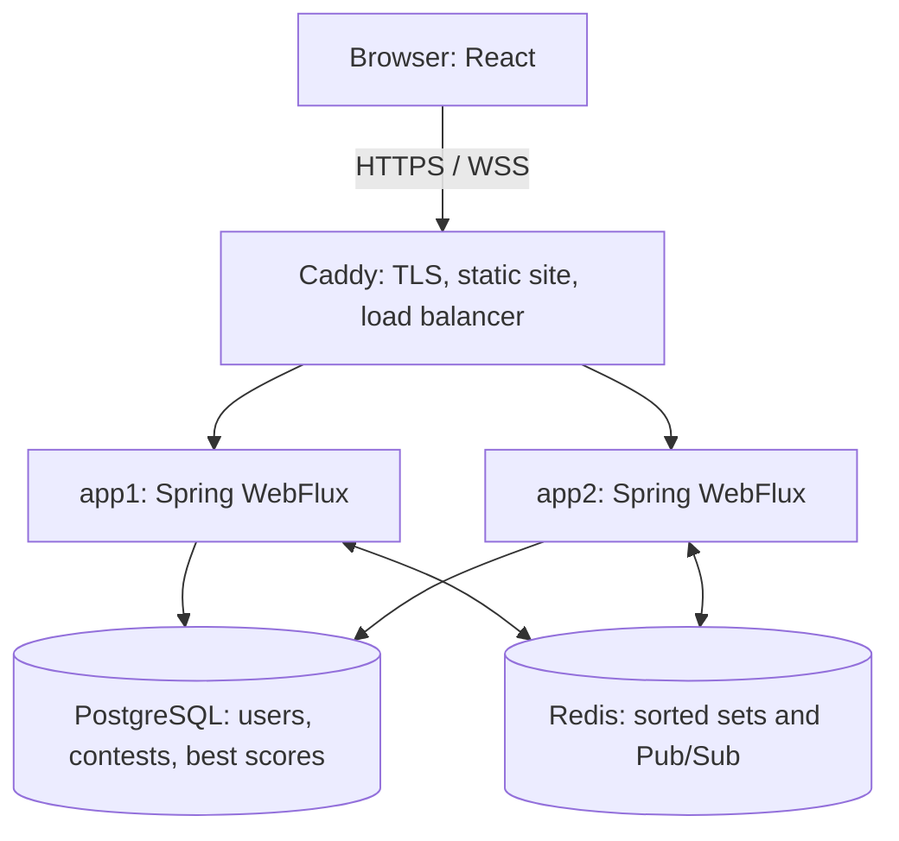
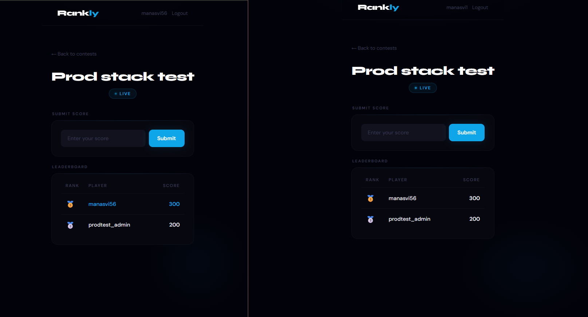
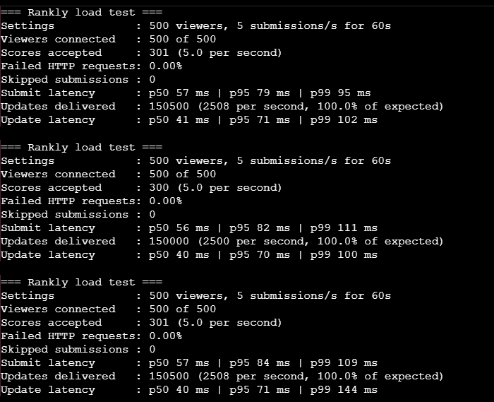
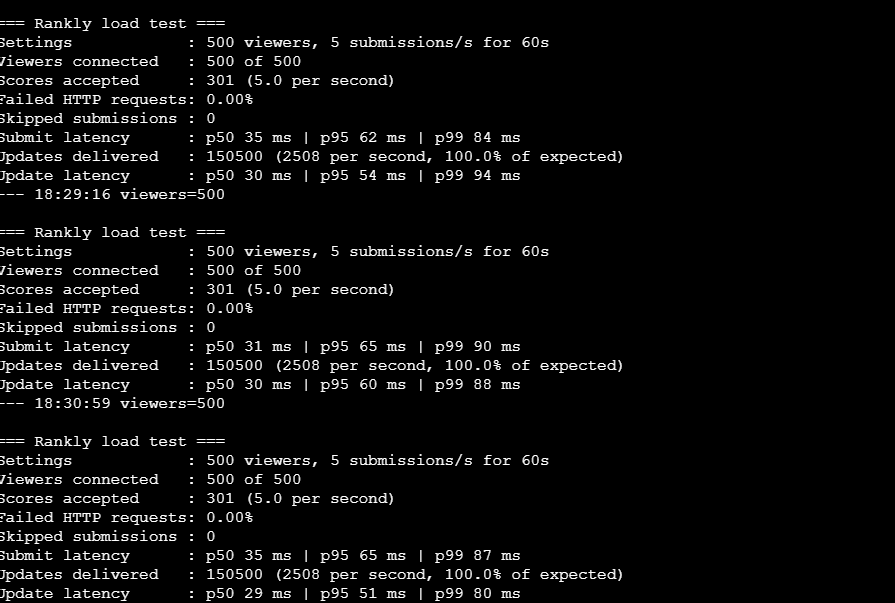

# Rankly: real-time contest leaderboard

Players submit scores and everyone watching a contest sees the ranking change live.

**Live demo:** https://rankly-demo.duckdns.org
(runs on an AWS free-plan server, so it may go offline; contests named "Load test" hold load-test data)

Java 21 · Spring Boot WebFlux · R2DBC · PostgreSQL · Redis · WebSocket · React · Caddy · Docker Compose · AWS EC2 · k6

## Highlights

- **Live updates across two app instances** through Redis Pub/Sub and WebSocket.
- **500 concurrent viewers** received about 2,500 messages/s with 100% delivery and 88 ms p99 latency in load tests.
- **Redis connections cut from 505 to 7** at 500 viewers, and p95 update latency from 71 ms to 54 ms.
- **Atomic ranking with exact tie-breaks:** score and time packed into one integer, saved with `ZADD GT`.

## Architecture



All five containers run on one EC2 `t4g.small` server (Mumbai) with Docker Compose.

### What happens when a score is submitted

1. The server reads the user from the signed JWT.
2. PostgreSQL saves the score only if it beats the user's best.
3. A Redis script updates the contest's sorted set only if the new value is higher.
4. If the ranking changed, the instance publishes the top 10 on the contest's Redis channel.
5. Every instance forwards the message to its own WebSocket viewers.

## Design decisions

### Redis sorted sets for ranking
An index on `(contest_id, score DESC)` lets PostgreSQL serve a top 10 quickly. Finding **one player's rank** is different: SQL has to count everyone above them, while `ZREVRANK` is O(log n). At small scale PostgreSQL alone would be enough. The cost of Redis is keeping a second copy in sync.

### Tie-breaking: earlier submission wins
A Redis score is a double, which holds whole numbers exactly up to 2^53. Each entry stores:

```
score × 2^23 + (2^23 − 1 − seconds since contest start)
```

A higher score always ranks first, and for equal scores the earlier one does. Limits: scores from 0 to 1,000,000,000, one-second resolution, and about 97 days of time ordering per contest. Beyond those, ties are ordered by user ID.

### Atomic updates
`ZADD GT` runs inside a small Lua script together with the key's expiry, so a lower score cannot overwrite a higher one.

### One Redis subscription per contest per instance
Viewers of a contest on one instance share a single subscription, which opens with the first viewer and closes after the last. A slow viewer skips to the newest leaderboard instead of delaying others.

### Stateless authentication
JWTs (24-hour expiry) carry the user ID and role. Either instance can verify them, so no sticky sessions are needed. Passwords are hashed with BCrypt off the event loop.

## Load test results

500 viewers, 5 score submissions/s for 60 s, median of 3 runs, load generated from a separate EC2 instance:

| | One subscription per viewer | Shared subscription |
|---|---|---|
| Peak Redis connections | 505 | **7** |
| Update latency p50 / p95 / p99 | 40 / 71 / 102 ms | **30 / 54 / 88 ms** |
| Messages delivered per second | ~2,500 | ~2,500 |
| Delivery / failed requests | 100% / 0% | 100% / 0% |

At 100 viewers latency was about the same. CPU showed no consistent change. Full results, method and limitations: [`loadtest/results.md`](loadtest/results.md).

## Problems found and fixed

| Problem | Fix |
|---|---|
| Anyone could change any user's score without logging in | The endpoint requires a token, and the user ID comes from it |
| The tie-break fraction wrapped about every 17 minutes, so a later submission could win | Packed integer encoding |
| Redis read the score and then wrote it in two steps (found in review, not reproduced) | Single atomic `ZADD GT` script |
| One Redis connection per viewer | Shared subscription per contest |
| Invalid input and access errors returned 500 | 400, 403 and 409 with a message |

## API

| Method and path | Access | Purpose |
|---|---|---|
| `POST /api/v1/auth/register` | Public | Register and receive a token |
| `POST /api/v1/auth/login` | Public | Log in and receive a token |
| `GET /api/v1/contests?status=ACTIVE` | Public | List contests |
| `GET /api/v1/contests/{id}` | Public | Contest details |
| `POST /api/v1/contests` | Admin | Create a contest |
| `POST /api/v1/contests/{id}/end` | Admin | End a contest |
| `POST /api/v1/contests/{id}/scores` | Logged in | Submit `{"score": 100}` |
| `GET /api/v1/contests/{id}/leaderboard?limit=50` | Public | Top entries (maximum 100) |
| `GET /api/v1/contests/{id}/rank/{userId}` | Public | One player's rank (`-1` if unranked) |
| `GET /api/v1/users/{id}` | Public | Public user profile |
| `GET /api/v1/health` | Public | Liveness check |
| `WS /ws/leaderboard/{contestId}` | Public | Live leaderboard updates |

## Run locally

You need Docker Desktop and Node.js.

```bash
git clone https://github.com/manasvirana/rankly.git
cd rankly
cp .env.example .env          # set DB_PASSWORD and JWT_SECRET

docker compose up -d          # PostgreSQL and Redis
docker build -t rankly-app .
docker run --rm --env-file .env -e DB_HOST=host.docker.internal -e REDIS_HOST=host.docker.internal -p 8080:8080 rankly-app
```

With Java 21 and Maven installed, `mvn spring-boot:run` can replace the last two commands.

In a second terminal:

```bash
cd frontend
npm install
npm run dev                   # http://localhost:5173
```

New accounts are normal users. To create contests, promote an account and log in again:

```bash
docker compose exec postgres psql -U admin -d leaderboard -c "UPDATE users SET role='ADMIN' WHERE username='your_username';"
```

## Deploy

1. Create an Ubuntu server and open ports 80 and 443. Restrict SSH.
2. Point a domain at it and install `docker.io`, `docker-compose-v2` and `docker-buildx`. Add swap on a 2 GB server.
3. Clone the repository and create `.env`:

```
DB_USERNAME=admin
DB_PASSWORD=<new random value>
JWT_SECRET=<openssl rand -hex 32>
SITE_ADDRESS=your-domain
COMPOSE_FILE=docker-compose.prod.yml
```

4. Build and start. Caddy obtains the HTTPS certificate automatically.

```bash
docker compose build app1
docker compose build web
docker compose up -d
```

To update: `git pull`, rebuild the changed service, then `docker compose up -d`.

## Known limitations

- No automated tests or CI in the repository yet.
- Redis leaderboards are not rebuilt from PostgreSQL if lost or expired (48 hours by default, 180 days in production).
- The page loads up to 50 entries, but live updates carry only the top 10.
- Contest start and end times are not enforced; an admin ends contests manually.
- No rate limiting, and some input is not validated (email format, password length, leaderboard `limit`).
- Tokens cannot be revoked or refreshed, and are stored in `localStorage`.
- Both instances share one server, so this is not a highly available setup.

## Screenshots

### Two users on the same contest
Captured on the local production setup.



### Home page


### Admin panel


### Load test on AWS, 500 viewers: before
One Redis subscription per viewer. Cropped to the three completed runs.



### Load test on AWS, 500 viewers: after
One shared Redis subscription per contest on each instance.



Full comparison: [`loadtest/results.md`](loadtest/results.md).

---

Built by [Manasvi Singh](https://github.com/manasvirana)
